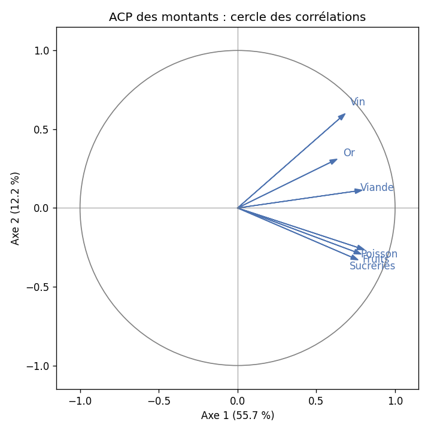
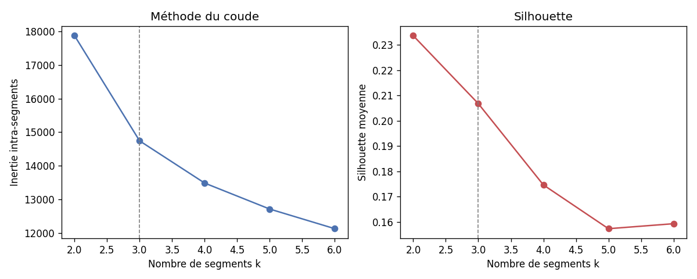
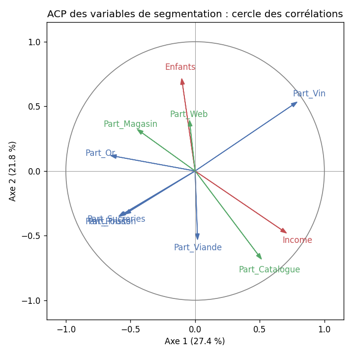
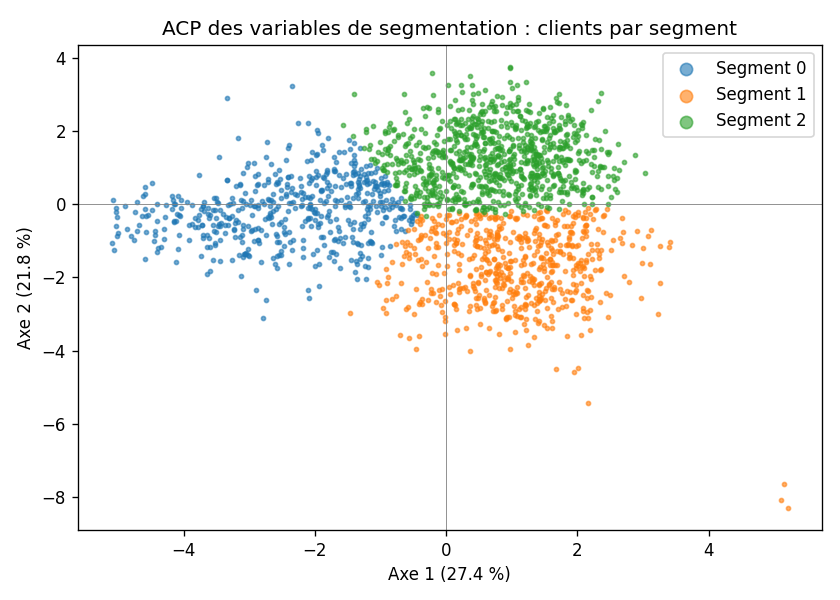

# Interprétation de la segmentation

Source : `python -m backend.segmentation`, table `analyse` (2 010 clients).

## Méthode

- 11 variables par client : revenu (`Income`), nombre d'enfants, part de chacun des 6 produits dans sa dépense, part de chacun des 3 canaux dans ses achats.
- Ni `Response`, ni `ID`, ni `Z_`. `Response` sert seulement à décrire les segments.
- Pipeline : imputation de `Income` par la médiane → standardisation → k-means (k = 3, n_init = 10, `config.SEED`).

## Pourquoi des parts plutôt que des montants

ACP sur les montants bruts des 6 produits : l'axe 1 porte 55,7 % de la variance, et les 6 produits y sont tous corrélés positivement (de 0,63 à 0,80).

L'axe 1 mesure donc le niveau de dépense (effet taille). Sur les montants, le k-means trierait les clients par niveau de dépense. Sur les parts, il compare la composition des achats.

## Choix de k

| k | Inertie | Baisse d'inertie | Silhouette |
|---|---|---|---|
| 2 | 17 875 | – | 0,234 |
| 3 | 14 741 | −17,5 % | 0,207 |
| 4 | 13 482 | −8,5 % | 0,175 |
| 5 | 12 708 | −5,7 % | 0,157 |
| 6 | 12 122 | −4,6 % | 0,159 |

- Coude : à k = 3, dernière forte baisse d'inertie.
- Silhouette : 0,207 à k = 3, proche du maximum (0,234 à k = 2).
- Métier : 3 profils lisibles et nommables.

## Lecture des axes (ACP sur les 11 variables)

Les 2 premiers axes résument 49,2 % de la variance.

| Axe | Côté positif | Côté négatif | Lecture |
|---|---|---|---|
| 1 (27,4 %) | Part vin (0,79), revenu (0,71), part catalogue (0,51) | Part or (−0,65), fruits (−0,59), poisson (−0,58), sucreries (−0,54), magasin (−0,45) | Aisance et vin, contre panier diversifié |
| 2 (21,8 %) | Enfants (0,71), part vin (0,53), part web (0,39) | Part catalogue (−0,68), viande (−0,53), revenu (−0,48) | Familles, contre ménages aisés achetant par catalogue |

## Les 3 personas

| Persona | Clients | Revenu médian | Avec enfants | Dépense médiane | Produits principaux | Canaux principaux | Taux de réponse | Gain si on contacte tout le segment |
|---|---|---|---|---|---|---|---|---|
| Familles modestes au panier varié | 534 | 29 548 | 80,7 % | 64 | Viande 25 %, Or 21 % | Magasin 59 %, Web 34 % | 9,6 % | −1 041 UM |
| Familles amatrices de vin | 871 | 49 090 | 95,4 % | 275 | Vin 64 %, Viande 20 % | Magasin 51 %, Web 37 % | 10,0 % | −1 656 UM |
| Aisés, peu d'enfants, vin et viande | 605 | 74 761 | 30,1 % | 1 253 | Vin 43 %, Viande 33 % | Magasin 42 %, Catalogue 31 % | 25,8 % | −99 UM |
| *Ensemble des clients* | 2 010 | 51 550 | 71,8 % | 397 | Vin 46 %, Viande 25 % | Magasin 50 %, Web 33 % | 14,6 % | −2 796 UM |

Actions :
- **Familles modestes au panier varié** : ne pas contacter, réponse faible (9,6 %).
- **Familles amatrices de vin** : ne pas contacter en masse, réponse faible (10,0 %).
- **Aisés, peu d'enfants, vin et viande** : segment le plus réceptif (25,8 %), mais pas rentable en bloc. Contacter tout le segment fait encore perdre 99 UM.

## Segments ou règles simples ?

| Ciblage | Contactés | Réponses | Taux | Gain |
|---|---|---|---|---|
| Familles modestes au panier varié | 534 | 51 | 9,6 % | −1 041 UM |
| Familles amatrices de vin | 871 | 87 | 10,0 % | −1 656 UM |
| Aisés, peu d'enfants, vin et viande | 605 | 156 | 25,8 % | −99 UM |
| Revenu Q4 | 497 | 135 | 27,2 % | −6 UM |
| Sans enfants | 566 | 156 | 27,6 % | +18 UM |
| Déjà accepté une campagne (baseline) | 416 | 168 | 40,4 % | +600 UM |
| Tout le monde | 2 010 | 294 | 14,6 % | −2 796 UM |

- Ne contacter que le segment aisé ramène la perte de −2 796 à −99 UM.
- Aucun segment n'atteint le seuil de rentabilité (27,3 %).
- La règle « sans enfants » fait un peu mieux (+18 UM). La baseline fait mieux (+600 UM).
- La segmentation dit qui exclure. Pour choisir qui contacter, il faut un score par client (modèle supervisé).

## Piste

Le produit promu par la campagne est inconnu. Avant une offre par produit (par exemple vin et viande pour le segment aisé), la tester sur une partie du segment, puis l'étendre aux clients qui y répondent.

## Limites

- Silhouette faible (0,207) : les clients forment un continuum plutôt que des groupes bien séparés.
- Le bloc produits pèse 6 variables sur 11 dans la distance (pas de pondération des blocs).
- Les 4 fiches suspectes de la Data Quality Card sont gardées.
- Segmentation descriptive, apprise sur les 2 010 clients. Elle n'est pas utilisée par le Random Forest.
